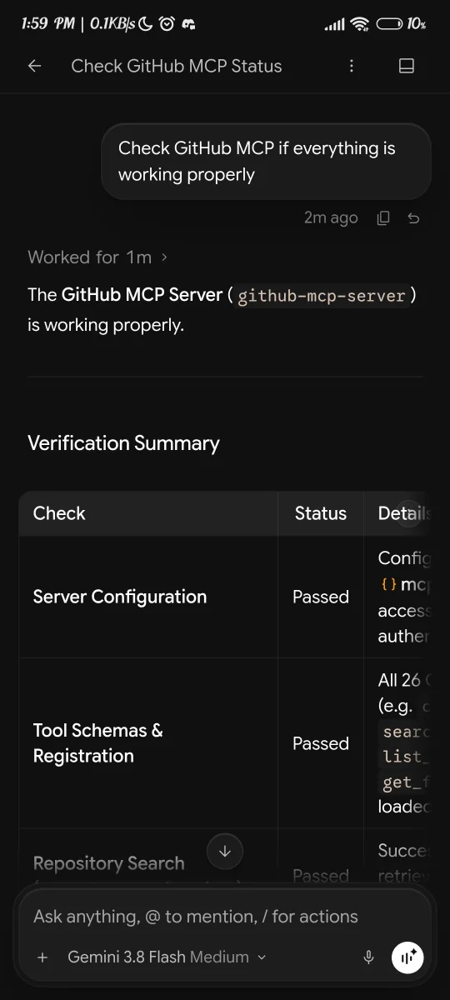
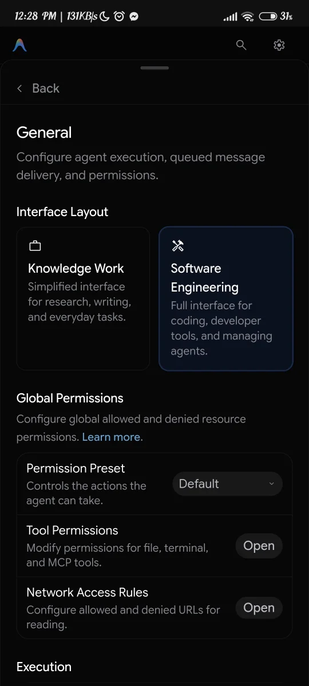
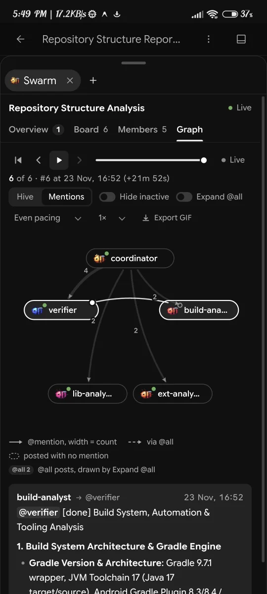

<div align="center">

  <br/>

  

  # Antigravity for Android

  **Autonomous AI development environment running natively on Android & ARM64 with Root (`uid=0`), Token-Saver optimizations, and built-in Backup & Restore.**

  [](https://android.com)
  [](https://arm.com)
  [](https://github.com/YuriRinkashime/antigravity-android/releases)
  [](https://github.com/YuriRinkashime)
  [](LICENSE)

  <br/>

  <picture>
    <source media="(prefers-color-scheme: dark)" srcset="docs/assets/hero_dark.png">
    <source media="(prefers-color-scheme: light)" srcset="docs/assets/hero_light.png">
    
  </picture>

</div>

---

### Overview

**Antigravity for Android** brings autonomous agentic coding directly to mobile hardware.

No PRoot, chroot, or virtualization overhead. Antigravity runs **bare-metal inside native Android userspace (Bionic)**, unleashing the full read/write speed of UFS storage and physical CPU cores. Inspect repositories, edit code across multiple files, run native ARM64 binaries, and manage system-level operations with root (`uid=0`) or Shizuku/Sui (`uid=2000`) completely on-device.

---

### App Previews

<div align="center">

| Voice Mode | MCP Diagnostics | Settings & Permissions | Swarm Graph | Swarm Hive |
| :---: | :---: | :---: | :---: | :---: |
| <a href="docs/assets/preview_1.png"></a> | <a href="docs/assets/preview_2.png"></a> | <a href="docs/assets/preview_3.png"></a> | <a href="docs/assets/preview_4.png"></a> | <a href="docs/assets/preview_5.png"></a> |

</div>

---

### Highlights in v2.34.15

* **Auto-Check Updates (`UpdateChecker`):** Automatically checks [`YuriRinkashime/antigravity-android`](https://github.com/YuriRinkashime/antigravity-android/releases) on launch (throttled to once every 6 hours, with Skip & changelog preview) plus a manual **Check for Updates (GitHub)** button in `QuickControlSheet`.
* **Token-Saver Optimization Suite:**
  * **75% smaller `AGENTS.md`** (`10.1 KB` → `2.5 KB`), with safe auto-migration on launch for existing installs.
  * **Background Sidecars OFF by default** (`TokenSaverPrefs`) so Automations never silently drain quota unless explicitly enabled in `QuickControlSheet`.
  * **0× blind retries on LLM/mutating RPCs** (`fetch-rewrite.js`), **double-tap send deduplication**, and a **long-chat `/compact` reminder** (`token_saver.js`).
* **Chat Image Paste (`AgyWebView` & `clipboard_image_paste.js`):** Paste screenshots and images directly into chat from Gboard, Samsung Keyboard (`commitContent`), or Android's clipboard.
* **Native Root Access (`RootBridge`, `agy-root`, `sudo`, `su`, `agy-sys`):** First-class `uid=0` support for **KernelSU / bakaSU / KernelSU-Next / SukiSU**, **Magisk**, and **APatch**, with global mount namespace (`-mm`), preserved `$HOME`/`$PREFIX`/`$PATH` + TLS certs, and `--fallback-rish`.
* **Portable 1-Tap Backup & Restore (`StateBackupManager` & `agy-sys backup/restore`):** Export and restore all local chats, brain artifacts, and rules as a portable `.zip` in `Download/Antigravity-Backups/` that survives uninstalls, Clear Data, and custom ROM flashes.
* **Crash & Anti-Kill Resilience (`RootResilience` & `FileDownloader`):** Automatic root Doze whitelisting + gentle `oom_score_adj` protection (`-100`), fixed 64 MiB static Base64 RAM leak, and `GODEBUG=netdns=cgo` + `GIT_SSL_CAINFO` fixes for Go and Git CLIs.
* **Native Quick-Control Sheet & Background Notifications:** Draggable `AGY` edge pill for live Root/Sui status, Re-check, Anti-Kill protection, Token-Saver toggle, Update Check, Backup/Restore, Desktop Mode, Core Restart, Log Export, and clickable background task completion notifications.

---

### Changelog

| Version | Highlights |
| :--- | :--- |
| **`v2.34.15`** | **Auto-Check Updates**, **Token-Saver Suite** (75% smaller `AGENTS.md`, sidecars OFF by default, 0× LLM send retries, double-tap dedupe, long-chat `/compact` warning), **Chat Image Paste**, and **English-only UI**. |
| **`v2.34.14`** | 1-tap portable `.zip` **Backup & Restore** of local chats, brain artifacts, and rules (`StateBackupManager`, `QuickControlSheet`, `agy-sys backup/restore`). |
| **`v2.34.13`** | **Crash & Anti-Kill Resilience** (`RootResilience` Doze whitelist + OOM protection, `FileDownloader` 64 MiB leak fix, `GODEBUG=netdns=cgo`), draggable **`AGY` Quick-Control Sheet**, **`agy-sys`** root CLI, and **clickable background agent notifications**. |
| **`v2.34.12`** | Native **`RootBridge`** (KernelSU / bakaSU / Magisk / APatch + `-mm`), **`agy-root` / `sudo` / `su`** wrappers, **`RootNoticeBanner`** (KernelSU/bakaSU & Sui setup guidance), **`GIT_SSL_CAINFO`** fix, and WebView stream auto-recovery. |

See full history in **[CHANGELOG.md](CHANGELOG.md)**.

---

### Quick Start

1. **Download APK** from [Releases](https://github.com/YuriRinkashime/antigravity-android/releases):
   * `antigravity.apk` — standard release (`com.agy`, port `45157`).
   * `antigravity-region-bypass.apk` — release with account eligibility check bypass.
2. **Grant Storage Permission** (`All Files Access`).
3. **Optional Root / Sui Setup:**
   * **KernelSU / bakaSU / KernelSU-Next / SukiSU:** Open your root manager, grant Superuser to **Antigravity (`com.agy`)**, then **restart the app**.
   * **Sui Module:** Allow **Antigravity (`com.agy`)** in Sui / Shizuku Manager, then **restart the app**.
   * **Magisk / APatch:** Grant the Superuser prompt in your manager app.
   * Verify anytime in terminal: `agy-root status` or `agy-sys info`
4. **Install Runtimes** via terminal or agent:
   ```bash
   pkg update && pkg install git python nodejs
   ```

---

### Building & Testing

```bash
# Build standard release APK (dist/antigravity.apk):
bash build.sh

# Build release APK with region bypass (dist/antigravity-region-bypass.apk):
bash build.sh --region-bypass

# Run all test suites:
bash test_all_modules.sh
```

---

### Repository Structure

```text
antigravity/
├── config/             # App constants, environment paths, and lean AI rules
├── modules/            # Decoupled core modules
│   ├── core/           # Binary unpacking, glibc loader, shims, SHA-256 manifest
│   ├── patches/        # Binary patch engine (syscall emulation, resolv, SIGILL)
│   ├── io/             # High-performance I/O Bus: event broker, FIFO pipes, sockets
│   ├── env/            # Path resolver, diagnostics, Flight Recorder logs, CLI
│   ├── builder/        # Gradle-free APK builder (javac, D8, aapt, zipalign, apksigner)
│   └── runner/         # Standalone runtime preparation, port probe, E2E tests
├── app/                # Android host app (RootBridge, QuickControlSheet, UpdateChecker, WebView)
├── web/                # Local web frontend, Token-Saver, clipboard image paste, themes
├── env/                # Bionic userspace, agy-root/sudo/agy-sys, pkg manager, liblse_compat
├── docs/assets/        # Screenshots and banners
├── CHANGELOG.md        # Full release changelog
├── build.sh            # Root APK build script
└── test_all_modules.sh # Test suite for all 6 modules
```

---

### Maintainer

Maintained by **[YuriRinkashime](https://github.com/YuriRinkashime)** — [`YuriRinkashime/antigravity-android`](https://github.com/YuriRinkashime/antigravity-android).

---

<div align="center">
  <sub>Licensed under the <a href="LICENSE">Apache 2.0 License</a></sub>
</div>
