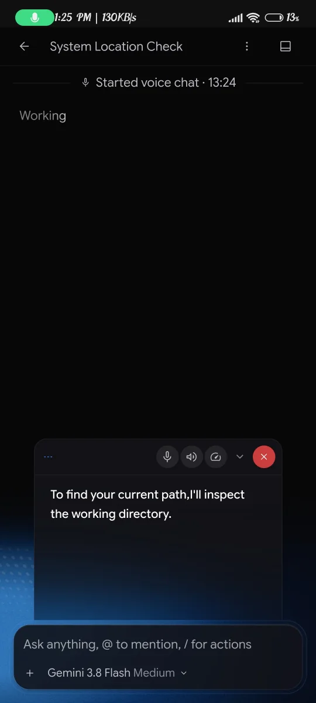
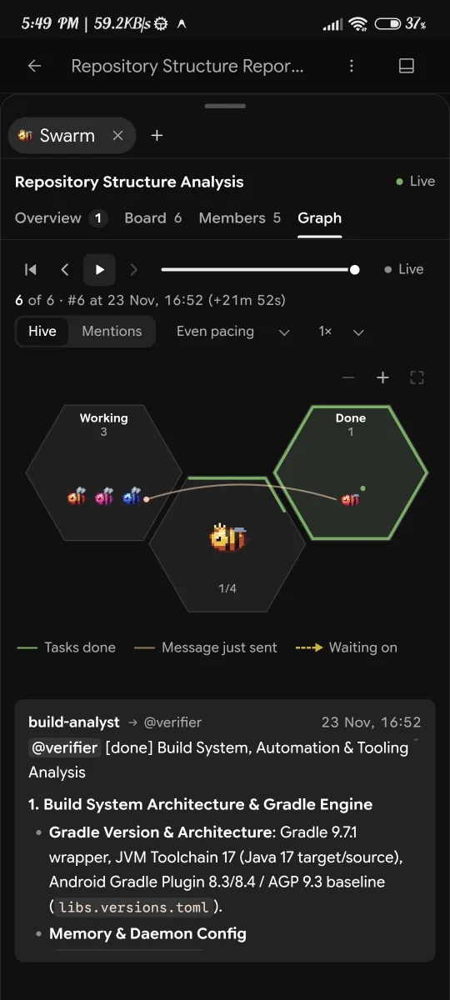

<div align="center">

  <p>
    <b>English</b> &nbsp;&bull;&nbsp; <a href="README.ru.md">Русский</a>
  </p>

  <br/>

  

  # Antigravity for Android (Root-Enhanced Fork)

> [!NOTE]
> Actively maintained fork of [`salmanbappi/antigravity-android`](https://github.com/salmanbappi/antigravity-android) & [`werdio325-png/antigravity-android`](https://github.com/werdio325-png/antigravity-android) with **native Root (`su`) support** (KernelSU / bakaSU / Magisk / APatch), smart CLI wrappers, Git TLS fixes, and stream auto-recovery.

**Autonomous AI development environment running natively on Android & ARM64.**

  [](https://android.com)
  [](https://arm.com)
  [](https://github.com/YuriRinkashime/antigravity-android/releases)
  [](LICENSE)

  <br/>

  <picture>
    <source media="(prefers-color-scheme: dark)" srcset="docs/assets/hero_dark.png">
    <source media="(prefers-color-scheme: light)" srcset="docs/assets/hero_light.png">
    
  </picture>

</div>

---

### Overview

**Antigravity for Android** brings autonomous agentic coding directly to mobile hardware.

No PRoot, chroot, or virtualization overhead. Antigravity runs **bare-metal inside native Android userspace (Bionic)**, unleashing the full read/write speed of UFS storage and physical CPU cores. Driven by Gemini models, the agent inspects repositories, authors code across multiple files, compiles binaries, and runs tests completely on-device.

---

### App Previews

<div align="center">

| Voice Mode | MCP Diagnostics | Settings & Permissions | Swarm Graph | Swarm Hive |
| :---: | :---: | :---: | :---: | :---: |
| <a href="docs/assets/preview_1.png"></a> | <a href="docs/assets/preview_2.png"></a> | <a href="docs/assets/preview_3.png"></a> | <a href="docs/assets/preview_4.png"></a> | <a href="docs/assets/preview_5.png"></a> |

</div>

---

### Highlights in v2.34.12 (Root Edition)

* **Native Root Access (`RootBridge`, `agy-root`, `sudo`, `su`):** First-class `uid=0` support for **KernelSU / bakaSU / KernelSU-Next / SukiSU**, **Magisk**, and **APatch**, with global mount namespace (`-mm`), preserved `$HOME`/`$PREFIX`/`$PATH` + TLS certs, and automatic `--fallback-rish` fallback.
* **Smart Root / Sui Setup Guidance:** Built-in [`RootNoticeBanner`](app/src/main/java/com/agy/ui/RootNoticeBanner.java) and CLI diagnostics automatically detect ungranted KernelSU/bakaSU or Sui states and guide users to grant permission & restart.
* **Out-of-the-Box Git HTTPS:** Bundled `GIT_SSL_CAINFO="$PREFIX/etc/tls/cert.pem"` across `CoreEnvironment`, `ShellBridgeInstaller`, and `ExecHandler`.
* **Stream Recovery & Auto-Reconnect:** Network change callbacks wake stalled WebView streams with `AbortSignal`-aware retry backoff.
* **Universal ARMv8.0-A Support & `/swarm`:** Includes ARMv8.0 LSE/SIMD emulation (`liblse_compat.so`), native splash, Desktop Mode, and `agy-daemon`.

---

### Key Features

* **Autonomous Agent:** Plans tasks, edits code across project trees, executes shell tools, and fixes build errors.
* **Elevated Control (Root + Shizuku/Sui):** Full `uid=0` root via `agy-root` / `sudo` (with `-mm` support) plus ADB-level `uid=2000` via Shizuku / Sui (`rish`).
* **Built-in `pkg` Manager:** Fast package manager installing development runtimes (`git`, `python`, `node`, `clang`) from Termux repos.
* **Adaptive Viewports:** Seamless touch-first mobile UI with optional desktop layout.
* **In-Place Upgrades:** Keeps `com.agy` and consistent keystore so updating APKs preserves sessions, workspace data, and root grants.

---

### Quick Start

1. **Download APK** from [Releases](https://github.com/YuriRinkashime/antigravity-android/releases):
   * `antigravity.apk` — standard release (original Google account checks).
   * `antigravity-region-bypass.apk` — release with account eligibility check bypass.
2. **Grant Storage Permission** (`All Files Access`).
3. **Optional Root / Sui Setup:**
   * **KernelSU / bakaSU / KernelSU-Next / SukiSU:** Open your root manager, grant Superuser to **Antigravity (`com.agy`)**, then **restart the app**.
   * **Sui Module:** Allow **Antigravity (`com.agy`)** in Sui / Shizuku Manager, then **restart the app**.
   * **Magisk / APatch:** Grant the Superuser prompt in your manager app.
   * Verify anytime in terminal: `agy-root status`
4. **Install Runtimes** via terminal or agent:
   ```bash
   pkg update && pkg install git python nodejs
   ```

---

### Building & Testing

```bash
# Build standard release APK (dist/antigravity.apk):
bash build.sh

# Build release APK with region bypass (dist/antigravity-region-bypass.apk):
bash build.sh --region-bypass

# Run all test suites:
bash test_all_modules.sh
```

---

### Repository Structure

```text
antigravity/
├── config/             # App constants, environment paths, and AI rules
├── modules/            # Decoupled core modules (v2.4+)
│   ├── core/           # Binary unpacking, glibc loader, shims, SHA-256 manifest
│   ├── patches/        # Binary patch engine (syscall emulation, resolv, SIGILL)
│   ├── io/             # High-performance I/O Bus: event broker, FIFO pipes, sockets
│   ├── env/            # Path resolver, diagnostics, Flight Recorder logs, CLI
│   ├── builder/        # Gradle-free APK builder (javac, D8, aapt, zipalign, apksigner)
│   └── runner/         # Standalone runtime preparation, port probe, E2E tests
├── app/                # Android host app (native splash, WebView, system bridges)
├── web/                # Local web frontend, desktop mode toggle, themes
├── env/                # Bionic userspace, Termux overlay, pkg manager, liblse_compat
├── docs/assets/        # Screenshots, banners, and diagrams
├── build.sh            # Root APK build script
└── test_all_modules.sh # Test suite for all 6 modules
```

> [!TIP]
> Each module in `modules/`, `app/`, `web/`, and `env/` includes its own dedicated `README.md` with in-depth technical documentation.

---

<div align="center">
  <sub>Licensed under the <a href="LICENSE">Apache 2.0 License</a></sub>
</div>
